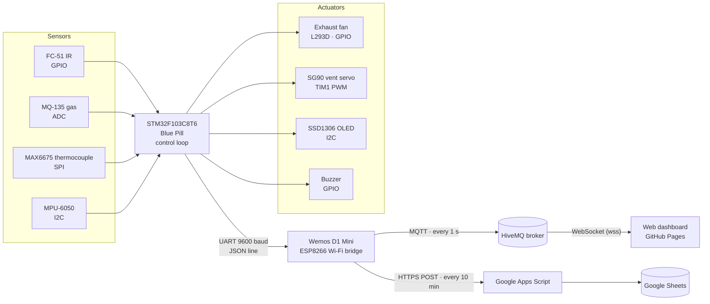
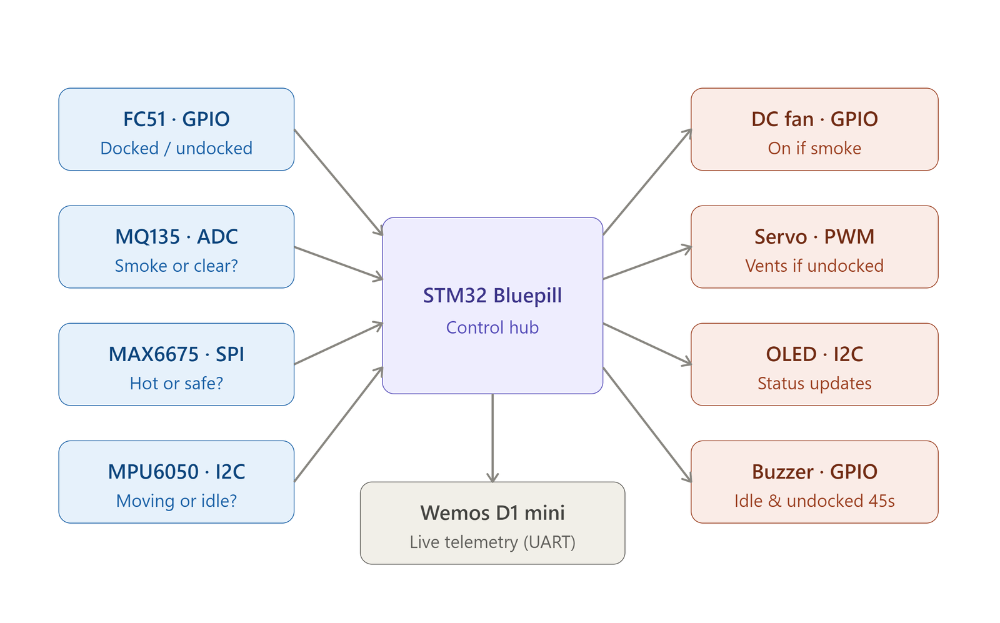
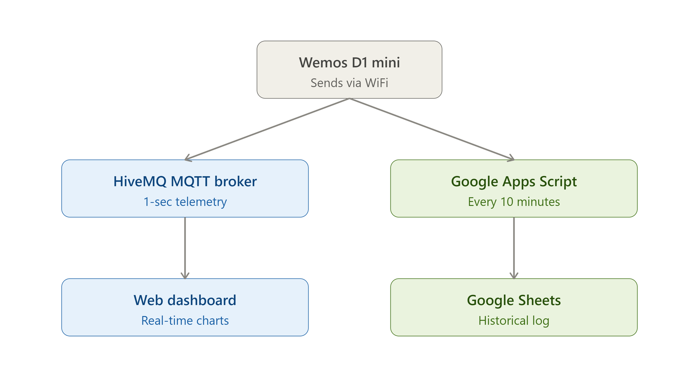
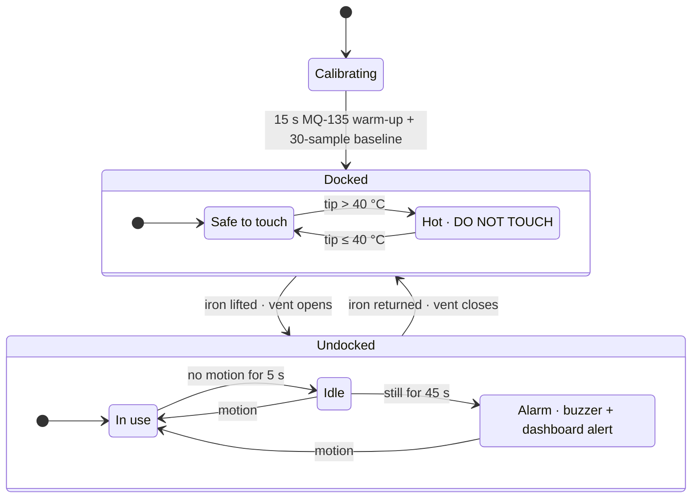
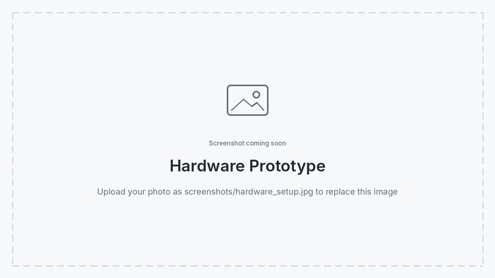
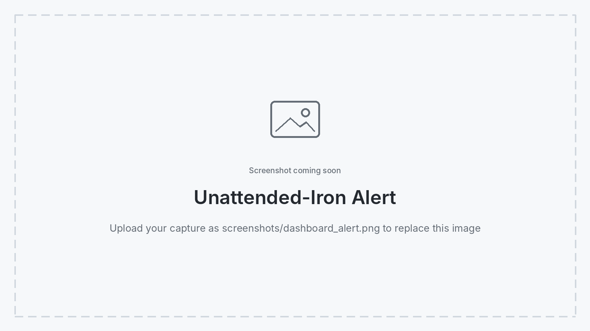
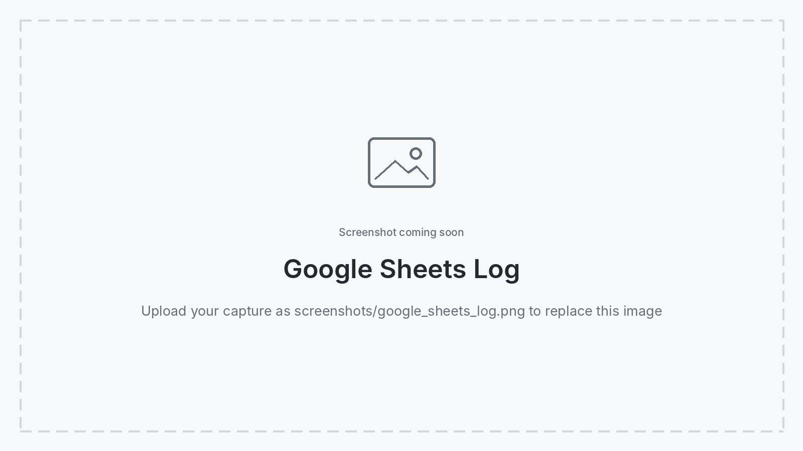

# 🔥 Smart Soldering Workbench & Safety Guardian


An IoT safety station for the soldering bench, built around an **STM32 Blue Pill**. Four sensors watch the iron — is it docked, is it moving, is it still hot, are flux fumes building up — and the station reacts on its own: an exhaust fan, a servo-driven vent flap, an OLED status screen and an alarm if the iron is left unattended. Live telemetry streams over Wi-Fi to a **web dashboard** every second and is logged to **Google Sheets** every 10 minutes.

**[▶ Open the interactive dashboard demo](https://rysahona12.github.io/smart-soldering-station-iot/web_dashboard/demo.html)** — no hardware needed.

<p align="center">
  
</p>
<p align="center"><em>Live dashboard: tip temperature, air quality, dock status and motion, with the raw MQTT telemetry log.</em></p>

## 👥 Authors

- **Raisa Mahabub Ahona**
- **Shams Akbar Aalok**
- **Al Mamun Oualid**
- **Tahsin Ramisha**

Department of Electrical and Computer Engineering, North South University<br>
CSE331 · Summer 2026 · Faculty: Dr. Mohammad Abdul Qayum

[📄 View Project Report (IEEE format)](Project_Report.pdf)

## ⚠️ The Problem

Soldering hazards are easy to overlook: rosin-flux fumes are a recognised respiratory hazard, a docked iron can stay hot long after use, and an iron left switched on and unattended is a burn and fire risk. Ordinary stations leave the user to notice all of this alone. This project puts the whole bench under continuous monitoring and acts automatically.

## ✨ Features

| Feature | How it works |
|---|---|
| 🌫️ **Fume detection + extraction** | MQ-135 with self-calibrating baseline; the exhaust fan runs while fumes are detected and the iron is in use |
| 🌡️ **Hot-tip warning** | MAX6675 K-type thermocouple; above **40 °C** the docked iron shows *DO NOT TOUCH — HOT!* |
| 🧲 **Dock detection** | FC-51 infrared sensor knows whether the iron is in its holder |
| 🏃 **Motion tracking** | MPU-6050 accelerometer distinguishes an iron in use from one lying idle |
| ⏰ **Unattended alarm** | Undocked + no motion for **45 s** → buzzer on the bench and an amber alert on the dashboard (red at 60 s) |
| 🌀 **Automatic ventilation** | SG90 servo opens a vent flap when the iron is lifted and closes it when docked |
| 📟 **Local status display** | 0.96″ SSD1306 OLED shows dock, motion, fume and temperature state |
| 📡 **Live telemetry** | Every second via MQTT to a browser dashboard — no backend server |
| 📈 **Historical log** | Every 10 minutes to Google Sheets through an Apps Script web app |

## 🏗️ System Architecture

The design separates **deterministic control** (STM32) from **network I/O** (ESP8266), so Wi-Fi latency can never stall the safety loop.



<table>
  <tr>
    <td width="55%"><p align="center"><em>Hardware-level control flow</em></p></td>
    <td width="45%"><p align="center"><em>Network control flow</em></p></td>
  </tr>
</table>

### Telemetry format

On every pass of its control loop the STM32 sends one compact JSON line to the Wemos over UART:

```json
{"t":305, "f":0, "d":1, "m":0}
```

| Field | Meaning |
|---|---|
| `t` | Tip temperature × 10 (integer, avoids `printf` float support on the MCU) → `30.5 °C` |
| `f` | `1` = fumes detected |
| `d` | `1` = iron docked |
| `m` | `1` = iron moved in the last 5 s |

The Wemos relays the latest line unchanged — to MQTT topic `smart_soldering_station/telemetry` every second, and to Google Sheets every 10 minutes.

## 🧠 Safety Logic



**Self-calibrating fume detection.** MQ-135 readings drift with temperature, humidity and sensor age, so a fixed threshold is unreliable. At power-up the station waits 15 s for the sensor heater, then averages 30 readings to find the clean-air baseline. Fumes are flagged when the 8-sample averaged ADC value rises **22 counts above baseline**, and the flag is held for 3 s to stop the fan chattering. While the iron sits in its dock, the baseline keeps tracking the room's air with a slow moving average (95 % old / 5 % new), so the detector adapts to the environment without learning fumes as "normal".

**Motion detection.** The MPU-6050's raw acceleration on each axis is compared with the previous sample; a jump larger than the threshold on any axis counts as movement. The iron is "moving" if it moved within the last 5 s.

## 🔌 Hardware

### STM32 peripheral map

| Device | Interface | CubeMX label / pins |
|---|---|---|
| MAX6675 thermocouple amplifier | SPI1 + chip-select GPIO | `MAX6675_CS` |
| MPU-6050 accelerometer | I2C1 (address `0x68`) | — |
| SSD1306 OLED | I2C1 (shared bus) | — |
| MQ-135 gas sensor | ADC1 | — |
| FC-51 IR proximity | GPIO input | `FC51_DOC` |
| L293D fan driver | GPIO outputs | `FAN_IN1`, `FAN_IN2` |
| Active buzzer | GPIO output | `BUZZER` |
| SG90 servo | TIM1 channel 1 PWM | — |
| Wemos D1 Mini | USART2 @ 9600 baud | PA2 (TX) → Wemos D5 (RX) |

### Bill of materials

| # | Component | Cost (BDT) |
|---|---|---|
| 1 | Breadboards | 200 |
| 2 | Wires | 200 |
| 3 | STM32 Blue Pill | 450 |
| 4 | ST-LINK V2 programmer | 400 |
| 5 | FC-51 IR sensor | 60 |
| 6 | MAX6675 + K-type thermocouple | 500 |
| 7 | MQ-135 gas sensor | 100 |
| 8 | MPU-6050 | 500 |
| 9 | SG90 servo | 100 |
| 10 | 5 V DC fan | 100 |
| 11 | Active buzzer | 100 |
| 12 | 0.96″ OLED display | 250 |
| | **Total** | **2,960** |

All software — STM32CubeMX/IDE, Arduino IDE, GitHub Pages, HiveMQ public broker and Google Sheets — is free.

<p align="center">
  
</p>
<p align="center"><em>The assembled prototype.</em></p>

## 💻 Web Dashboard

A single self-contained HTML file — no build step and no backend. It connects straight to the HiveMQ broker over secure WebSockets from the browser.

- Four animated sensor cards: temperature, air quality, dock and motion
- Raw MQTT telemetry log with timestamps
- Packet-age indicator and connection status
- **Escalating unattended-iron alert:** an amber page-wide warning at 45 s and a red siren state at 60 s

| File | Purpose |
|---|---|
| [`web_dashboard/index.html`](web_dashboard/index.html) | Live dashboard — subscribes to the hardware's MQTT topic |
| [`web_dashboard/demo.html`](web_dashboard/demo.html) | Interactive demo — set temperature, air, dock, motion and idle time by hand to see every state without hardware |

<p align="center">
  
</p>
<p align="center"><em>The dashboard escalates when the iron has been undocked and still for too long.</em></p>

<p align="center">
  
</p>
<p align="center"><em>Ten-minute history in Google Sheets, written by the Apps Script web app.</em></p>

## 🚀 Setup

### A. STM32 Blue Pill firmware

1. Create an **STM32CubeIDE** project for the STM32F103C8T6 and enable ADC1, I2C1, SPI1, TIM1 (CH1 PWM), USART2 and the GPIO pins with the labels in the peripheral map above.
2. Add an SSD1306 driver library that provides `ssd1306.h` and `fonts.h`.
3. Replace the generated `Core/Src/main.c` with [`firmware/stm32_bluepill/main.c`](firmware/stm32_bluepill/main.c).
4. Set **USART2 to 9600 baud** — it must match `STM32Serial.begin(9600)` in the Wemos sketch, or the telemetry arrives garbled.
5. Build and flash with an ST-LINK V2. Connect STM32 **PA2 (TX) → Wemos D5 (RX)** and share a common ground.

### B. Wemos D1 Mini firmware

1. Open [`firmware/wemos_d1_mini/wemos_d1_mini.ino`](firmware/wemos_d1_mini/wemos_d1_mini.ino) in the Arduino IDE with the ESP8266 board package installed.
2. Install **PubSubClient** (Nick O'Leary) from the Library Manager. `ESP8266WiFi`, `ESP8266HTTPClient`, `WiFiClientSecure` and `SoftwareSerial` come with the board package.
3. Fill in `ssid`, `password` and `google_script_url` (from step C).
4. Flash the board.

### C. Google Sheets logging

1. Create a Google Sheet with the columns `Timestamp | Temperature (°C) | Fumes | Dock Status | Motion Status`.
2. Open **Extensions → Apps Script** and paste in [`google_apps_script/Code.gs`](google_apps_script/Code.gs).
3. **Deploy → New deployment → Web app**, set access to **Anyone**, and copy the URL into `google_script_url`.

### D. Web dashboard

Enable **GitHub Pages** for this repository (Settings → Pages → *Deploy from a branch* → `main` / root). The dashboard is then served at `…/web_dashboard/` and the demo at `…/web_dashboard/demo.html`. It also works when opened directly from disk.

## 📁 Project Structure

```
├── firmware/
│   ├── stm32_bluepill/main.c         Sensor fusion, safety logic, OLED, servo, UART telemetry
│   └── wemos_d1_mini/                ESP8266 Wi-Fi bridge: MQTT (1 s) + Google Sheets (10 min)
├── web_dashboard/
│   ├── index.html                    Live MQTT dashboard
│   └── demo.html                     Interactive demo — no hardware needed
├── google_apps_script/Code.gs        Sheets logging web app
├── assets/                           Architecture diagrams
├── screenshots/                      Dashboard captures and hardware photos
├── Project_Report.pdf                Full IEEE-format report
├── LICENSE
└── README.md
```

## 🤝 Individual Contributions

| Member | Contribution |
|---|---|
| **Raisa Mahabub Ahona** | STM32 SPI (MAX6675) and PWM (SG90 servo) · website front end |
| **Al Mamun Oualid** | STM32 I2C (OLED, MPU-6050) · website backend |
| **Tahsin Ramisha** | STM32 GPIO interrupts (exhaust fan, FC-51, buzzer) and ADC (MQ-135) · website database |
| **Shams Akbar Aalok** | Complete hardware setup · STM32 integration and debugging (two-stage MQ-135 calibration, UART) · Wemos D1 Wi-Fi bridge connecting backend and database |

The project was completed in six weeks (27 July – 7 September 2026): planning and literature review, component selection, wiring, firmware, website, system integration, and testing.

## ⚙️ Known Limitations

- **Public MQTT broker.** `broker.hivemq.com` has no authentication or uptime guarantee, and anyone can publish to the topic. Fine for a demo; use a private broker with credentials for real deployments.
- **Blocking Sheets upload.** The HTTPS POST to Google Sheets blocks the Wemos for about a second every 10 minutes. Only that log entry can be affected — the live MQTT feed is not.
- **Temperature is refreshed while docked.** The thermocouple is read when the iron is in its dock, which is where the hot-to-touch warning matters; while the iron is in use the last docked reading is reported.

## 📜 License & Attribution

This project is released under the **Creative Commons Attribution-NonCommercial 4.0 International (CC BY-NC 4.0)** license.

**You are free to:**
- **Share** — copy and redistribute the material in any medium or format.
- **Adapt** — remix, transform, and build upon the material.

**Under the following terms:**
- **Attribution (Credit Required):** You must give appropriate credit to the authors, provide a link to this repository, and indicate if changes were made.
- **NonCommercial:** You may not use the material for commercial purposes without explicit permission.

If you use this work in your own research or project, please cite:
*Aalok, S. A., Ahona, R. M., Oualid, A. M., & Ramisha, T. (2026). Smart Soldering Workbench & Safety Guardian. GitHub Repository.*
